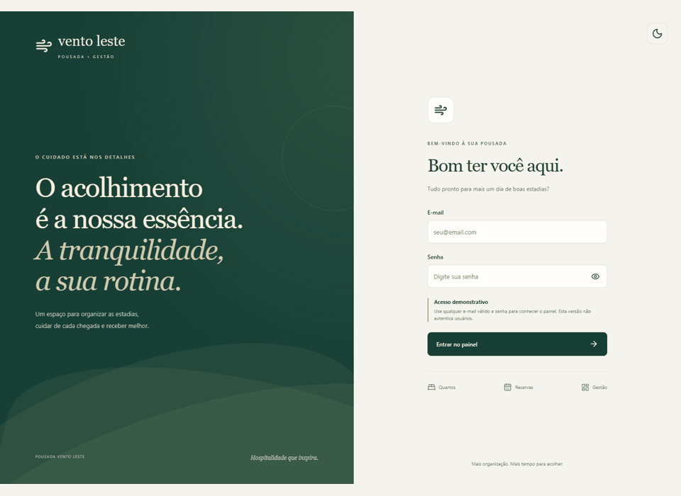
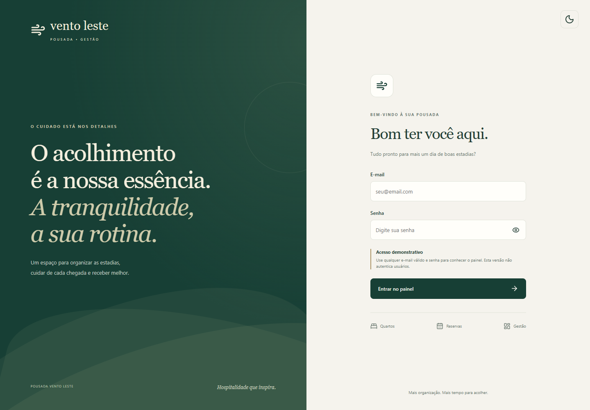
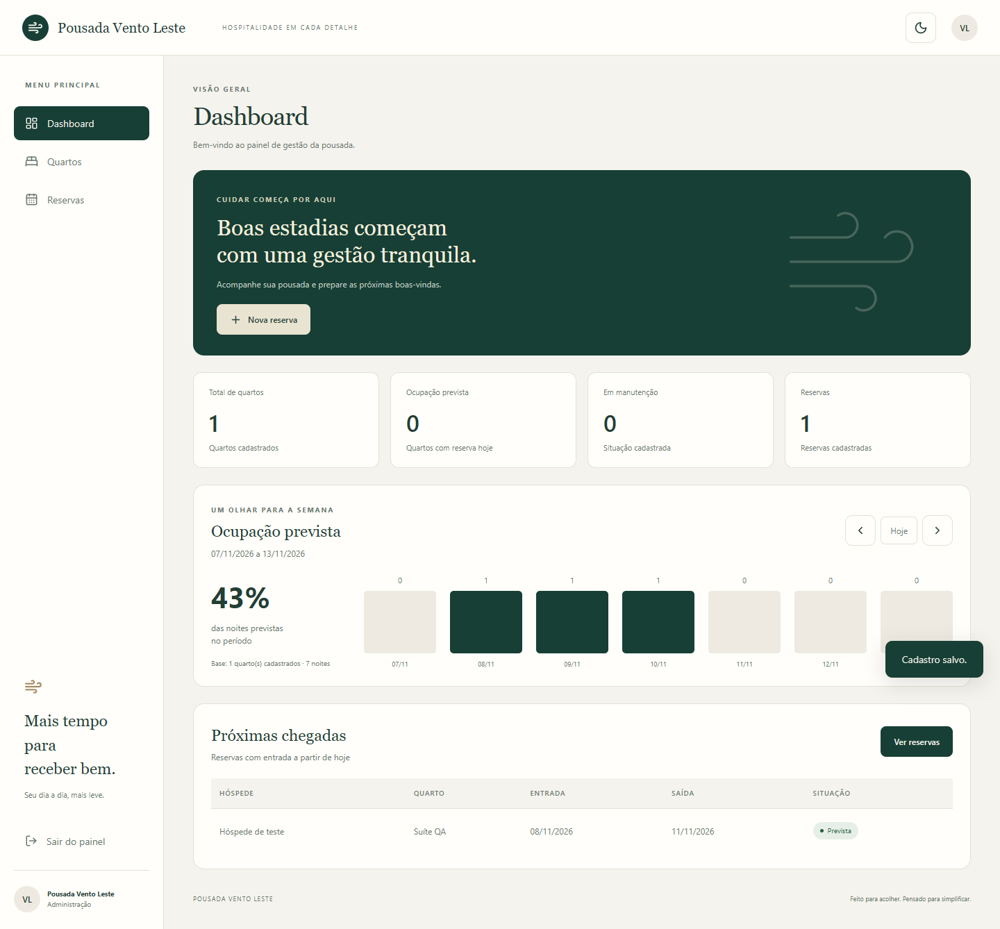
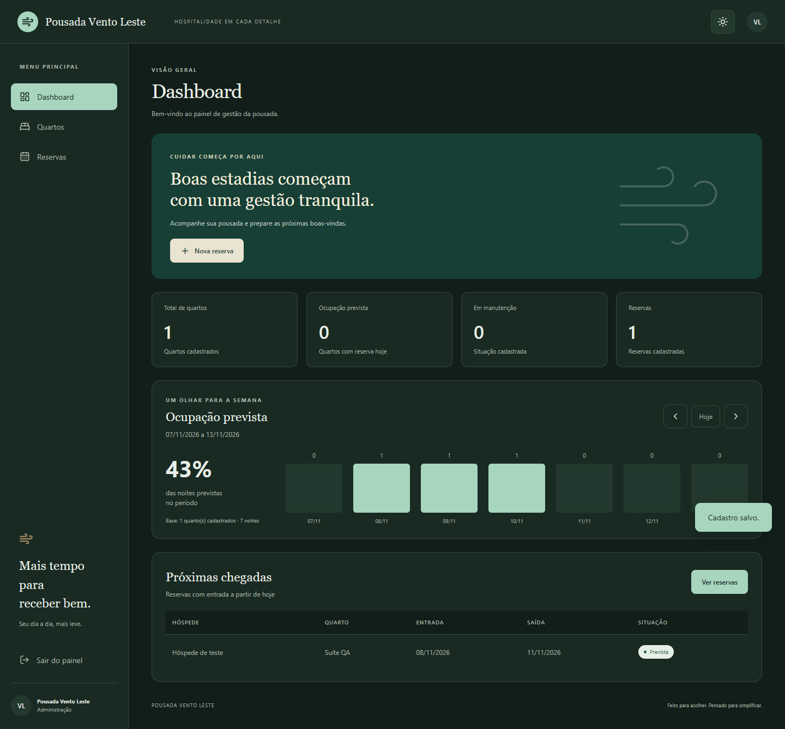
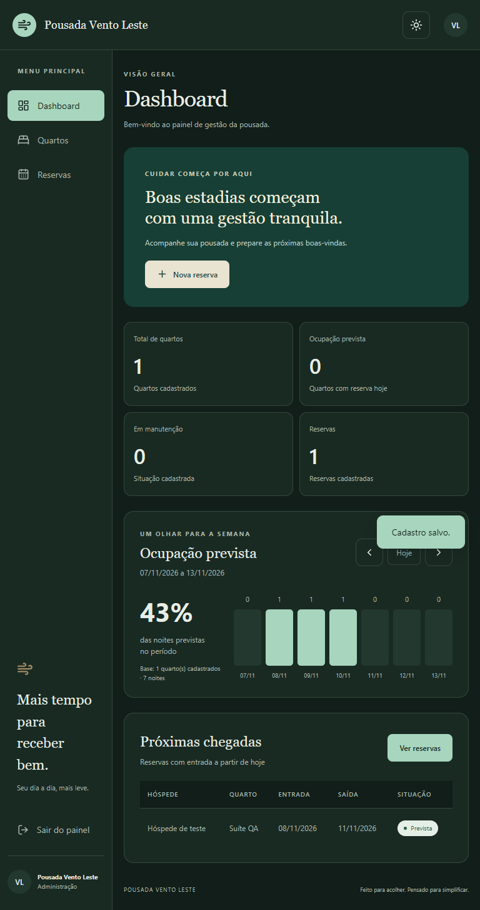
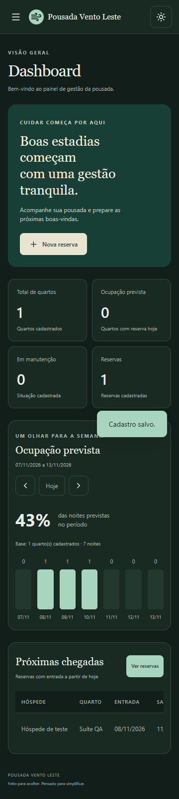
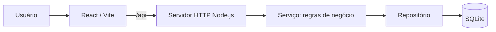
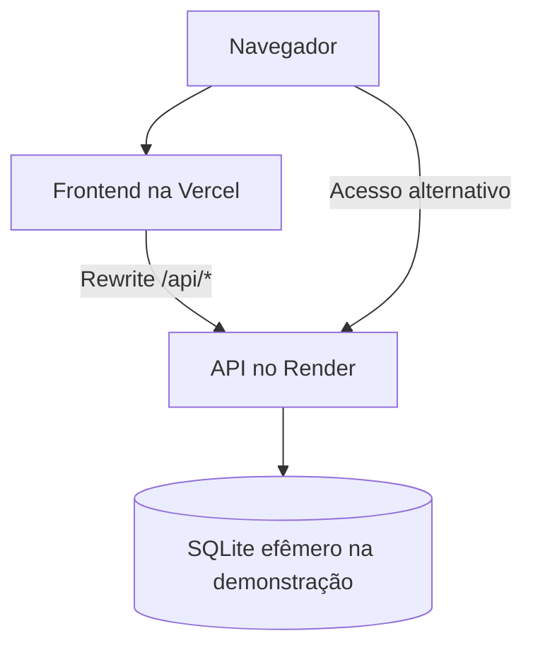

<div align="center">

# 🌿 Pousada Vento Leste

### Gestão tranquila. Mais tempo para acolher.

## 🚀 [ABRIR A APLICAÇÃO NA VERCEL](https://agendamento-pousada-teste.vercel.app)

**Experimente o painel online — sem instalar nada.**

[](https://agendamento-pousada-teste.vercel.app)
[](https://agendamento-pousada-teste.onrender.com)


*Quartos, reservas e ocupação em uma interface pensada para o dia a dia da pousada.*

</div>

> [!TIP]
> **Como entrar:** informe qualquer e-mail válido e uma senha não vazia. O acesso é **demonstrativo**: não há autenticação real, criação de conta ou validação de credenciais. A senha não é enviada nem armazenada.

> [!IMPORTANT]
> A versão online é para demonstração. A API é pública e não protege os cadastros por usuário. Use apenas dados fictícios. No Render gratuito, o banco SQLite é **perdido após reinícios, republicações ou suspensão**. Veja as [limitações do plano gratuito](https://render.com/docs/free).

---

## 🎬 Conheça a interface

<div align="center">

[](https://agendamento-pousada-teste.vercel.app)

*Sequência animada de capturas reais da interface. Clique para abrir a aplicação.*

</div>

<details>
<summary><strong>♿ Prefere uma prévia sem movimento? Abra as capturas estáticas</strong></summary>

- [Página inicial e login](screenshots/login-desktop.png)
- [Dashboard no tema claro](screenshots/dashboard-desktop.png)
- [Dashboard no tema escuro](screenshots/dashboard-dark.png)
- [Layout em tablet — 768 px](screenshots/dashboard-768.png)
- [Layout em celular — 360 px](screenshots/dashboard-360.png)

</details>

## 🧭 Navegação

[Visão geral](#-visão-geral) · [Funcionalidades](#-funcionalidades) · [Capturas](#-capturas-de-tela) · [Tecnologias](#-tecnologias) · [Instalação](#-executar-localmente) · [API](#-api) · [Deploy](#-publicação-online) · [Testes](#-validação) · [FAQ](#-perguntas-frequentes)

## 🏡 Visão geral

O **Pousada Vento Leste** é um sistema de gestão de acomodações e reservas com frontend em React, API HTTP em Node.js e banco SQLite integrado ao Node.

A identidade visual combina **verde profundo**, tons de **areia**, títulos com tipografia serifada e ícones Lucide. Os temas claro e escuro, as buscas e o resumo semanal ajudam a organizar as hospedagens.

### Um fluxo simples

1. Acesse o [painel na Vercel](https://agendamento-pousada-teste.vercel.app).
2. Entre pelo formulário demonstrativo.
3. Cadastre os quartos, suas capacidades e diárias.
4. Crie reservas com hóspede, período e quantidade de pessoas.
5. Acompanhe as próximas chegadas e a ocupação prevista.

## ✨ Funcionalidades

| Área | O que você pode fazer |
| :--- | :--- |
| 🌿 Página inicial | Acessar o painel demonstrativo e mostrar/ocultar a senha |
| 📊 Dashboard | Consultar quartos cadastrados, ocupação prevista de hoje, manutenção e reservas |
| 📅 Ocupação semanal | Navegar entre semanas e consultar quartos reservados por noite |
| 🧳 Próximas chegadas | Ver até cinco reservas futuras, ordenadas pela data de entrada |
| 🛏️ Quartos | Criar, listar, editar, excluir, buscar e filtrar por situação |
| 📝 Reservas | Criar, listar, editar, excluir, buscar por hóspede e filtrar por quarto |
| 💰 Valores | Consultar diária e total calculado pela API, em reais |
| 🌓 Aparência | Alternar claro/escuro; a preferência fica salva neste navegador |
| 📱 Responsividade | Navegar no celular, tablet e desktop; rolar tabelas horizontalmente |
| ⌨️ Interação | Usar foco visível, navegação por teclado e modais com contenção de foco |
| 🍃 Movimento | Transições discretas que respeitam `prefers-reduced-motion` |
| 🔄 Estados | Distinguir carregamento, lista vazia e falha de API; tentar carregar novamente |

### Regras e indicadores

- A capacidade do quarto deve ser um inteiro positivo; seu preço deve ser maior que zero.
- A reserva precisa de quarto, hóspede, datas válidas e quantidade de pessoas compatível com a capacidade.
- A saída deve ser posterior à entrada. Datas passadas não são proibidas por uma regra adicional de frontend.
- Reservas do mesmo quarto não podem se sobrepor. **Saída e nova entrada no mesmo dia são permitidas.**
- A API calcula `valorTotal = número de noites × valorDiaria`, arredondado para duas casas decimais.
- Um quarto com reservas associadas precisa ter essas reservas removidas antes de ser excluído.
- Telefone e observações são opcionais.

> **Ocupação prevista ≠ check-in realizado.** O projeto não registra pagamentos, despesas, cancelamentos ou confirmação de check-in. Valores de reservas não representam faturamento recebido.

<details>
<summary><strong>🧮 Como a ocupação é calculada?</strong></summary>

Uma reserva ocupa a noite de uma data quando `entrada <= data` e `saida > data`. Cada quarto é contado uma única vez por dia.

```text
Ocupação prevista do dia = quartos distintos com reserva naquela noite

Taxa semanal = soma dos quartos reservados em cada uma das 7 noites
               ---------------------------------------------------- × 100
                    quartos atualmente cadastrados × 7 noites
```

A base é o inventário **atualmente cadastrado**, sem descontar manutenção silenciosamente. Sem quartos, o painel mostra ausência de base em vez de uma porcentagem fictícia.

O painel usa a data civil de `America/Sao_Paulo`; a navegação de dias usa aritmética em UTC para evitar deslocamentos por horário de verão. As fórmulas ficam em [`src/metrics.mjs`](src/metrics.mjs).

</details>

## 📸 Capturas de tela

As imagens abaixo foram obtidas durante testes em **banco temporário isolado**. Os registros de QA não são dados reais da pousada e não são inseridos na demonstração online.

### Página inicial com login



### Dashboard — tema claro



<details>
<summary><strong>🌙 Ver dashboard no tema escuro</strong></summary>



</details>

<details>
<summary><strong>📱 Ver versões para tablet e celular</strong></summary>

| Tablet — 768 px | Celular — 360 px |
| :---: | :---: |
|  |  |

</details>

## 🧰 Tecnologias

| Camada | Tecnologia | Responsabilidade |
| :--- | :--- | :--- |
| Interface | React 19.2 | Telas, formulários, estado e navegação |
| Build | Vite 7.2 | Desenvolvimento e geração de arquivos estáticos |
| Estilos | CSS com variáveis | Tokens visuais, responsividade, temas e transições |
| Ícones | Lucide React | Ícones consistentes para navegação e ações |
| Servidor | Node.js 24+ / `node:http` | HTTP, arquivos estáticos e rotas da API |
| Dados | `node:sqlite` | Persistência, consultas e transações |
| Hospedagem | Vercel + Render | Frontend público e API integrada |

## 🚀 Executar localmente

**Pré-requisitos:** [Git](https://git-scm.com/) e [Node.js 24 ou superior](https://nodejs.org/), com npm. O deploy no Render usa Node `24.11.0`.

```bash
git clone https://github.com/PedroGiffoni/Agendamento-Pousada-Teste.git
cd Agendamento-Pousada-Teste
npm ci
npm start
```

Abra **[http://localhost:3000](http://localhost:3000)**. O comando `npm start` compila o frontend e inicia o servidor. O banco começa vazio na primeira execução.

### Desenvolvimento com atualização automática

Em dois terminais, dentro da pasta do projeto:

```bash
# Terminal 1 — API na porta 3000
npm run api
```

```bash
# Terminal 2 — frontend Vite
npm run dev
```

Abra o endereço exibido pelo Vite, normalmente [http://127.0.0.1:5173](http://127.0.0.1:5173). O proxy de desenvolvimento encaminha `/api` à porta `3000`.

### Comandos disponíveis

| Comando | Resultado |
| :--- | :--- |
| `npm ci` | Instala as dependências conforme o lockfile |
| `npm run dev` | Inicia o frontend de desenvolvimento |
| `npm run api` | Inicia somente o servidor/API |
| `npm run build` | Compila o frontend para `dist/` |
| `npm start` | Compila e inicia a aplicação completa |
| `node --test tests/metrics.test.mjs` | Executa os testes de datas e ocupação |

### Configuração

| Item | Comportamento |
| :--- | :--- |
| `PORT` | Porta do servidor; padrão `3000` |
| `NODE_VERSION` no Render | Runtime configurado como `24.11.0` |
| `vercel.json` | Build Vite e encaminhamento de `/api/*` ao Render |
| `vite.config.mjs` | Proxy local da API e configuração de JSX |

Não é necessário configurar credenciais ou arquivo `.env` para executar esta versão localmente.

## 🗂️ Estrutura e arquitetura

```text
Agendamento-Pousada-Teste/
├── src/
│   ├── main.jsx           # Painel, listagens e formulários
│   ├── welcome.jsx        # Página inicial e preferência de tema
│   ├── occupancy.jsx      # Visualização semanal de ocupação
│   ├── metrics.mjs        # Cálculos de datas e ocupação
│   └── style.css          # Identidade visual e responsividade
├── servico/pousada.js     # Validações e regras de negócio
├── dados/repositorio.js  # SQLite, consultas e transações
├── tests/metrics.test.mjs # Testes das fórmulas
├── screenshots/           # Capturas reais e prévia GIF
├── server.js              # Servidor HTTP e API
├── vercel.json            # Configuração da Vercel
├── vite.config.mjs        # Configuração do Vite
└── package.json           # Scripts e dependências
```



Ao criar uma reserva, o serviço valida capacidade e sobreposição e calcula o total. A validação e a gravação são feitas na mesma transação para evitar reservas concorrentes conflitantes.

## 🔌 API

As chamadas usam JSON. Erros retornam um objeto com o campo `erro`.

| Método | Rota | Operação |
| :---: | :--- | :--- |
| `GET` | `/api/quartos` | Listar quartos |
| `POST` | `/api/quartos` | Criar quarto |
| `PUT` | `/api/quartos/:id` | Atualizar quarto |
| `DELETE` | `/api/quartos/:id` | Excluir quarto |
| `GET` | `/api/reservas` | Listar reservas |
| `GET` | `/api/reservas?quartoId=1` | Listar reservas de um quarto |
| `POST` | `/api/reservas` | Criar reserva |
| `PUT` | `/api/reservas/:id` | Atualizar reserva |
| `DELETE` | `/api/reservas/:id` | Excluir reserva |

<details>
<summary><strong>📦 Exemplos de payloads para testar localmente</strong></summary>

**Quarto — `POST /api/quartos`**

```json
{
  "nome": "Suíte Jardim",
  "capacidade": 2,
  "preco": 180,
  "status": "Disponível",
  "descricao": "Exemplo fictício para testes locais."
}
```

**Reserva — `POST /api/reservas`**

Use o `id` devolvido ao criar o quarto. O total é calculado pelo servidor.

```json
{
  "quartoId": 1,
  "hospede": "Hóspede de exemplo",
  "telefone": "",
  "entrada": "2026-12-10",
  "saida": "2026-12-12",
  "hospedes": 2,
  "valorDiaria": 180,
  "observacoes": "Reserva fictícia para teste local."
}
```

**Exemplo de resposta de erro:**

```json
{
  "erro": "Este quarto já possui reserva nesse período."
}
```

</details>

## 💾 Banco de dados e backup

O servidor cria `pousada.db` na raiz, com as tabelas `quartos` e `reservas`. Em execução local, os cadastros permanecem após reiniciar o processo, desde que o arquivo seja preservado.

- **Backup:** pare o servidor e copie `pousada.db` para um local seguro.
- **Restauração:** com o servidor parado, coloque a cópia na raiz antes de iniciar.
- **Banco anterior:** use uma cópia compatível do arquivo da versão anterior.
- **Importação antiga:** `db.json` é importado antes da primeira execução, quando ainda não existe `pousada.db`.
- **Git:** bancos, dependências, arquivos `.env` e `dist/` estão no `.gitignore`.

> [!WARNING]
> A persistência local não se aplica ao disco efêmero do Render Free. Antes de usar dados reais, implemente autenticação e armazenamento persistente.

## ☁️ Publicação online

| Ambiente | Endereço | Papel |
| :--- | :--- | :--- |
| **Vercel** | **[agendamento-pousada-teste.vercel.app](https://agendamento-pousada-teste.vercel.app)** | Interface Vite; `/api/*` encaminhado ao Render |
| Render | [agendamento-pousada-teste.onrender.com](https://agendamento-pousada-teste.onrender.com) | API Node/SQLite e interface estática |
| GitHub | [PedroGiffoni/Agendamento-Pousada-Teste](https://github.com/PedroGiffoni/Agendamento-Pousada-Teste) | Código e configurações na branch `main` |



**Render:** build `npm ci && npm run build`, inicialização `node server.js`, plano gratuito e Node `24.11.0`.

**Vercel:** framework Vite, build `npm run build`, saída `dist` e rewrite definido em [`vercel.json`](vercel.json).

O serviço gratuito do Render pode levar cerca de um minuto para responder após um período sem tráfego. A interface da Vercel pode abrir antes de a API despertar. Consulte a [documentação do Render Free](https://render.com/docs/free).

## ✅ Validação

### Verificações realizadas na entrega

- [x] Build de produção concluído.
- [x] Quatro testes automatizados de datas e ocupação aprovados.
- [x] Entrada demonstrativa e dashboard verificados no navegador.
- [x] Criação, edição e exclusão de quartos e reservas testadas com API real em banco isolado.
- [x] Estados de lista vazia e falha da API verificados.
- [x] Capturas de dashboard em 360, 768 e 1440 px, incluindo temas claro e escuro.
- [x] Login, dashboard e consultas de quartos/reservas verificados nos dois endereços online.

Essas verificações registram a entrega; os badges acima identificam tecnologias e **não são monitores de disponibilidade ou de CI**. Não foi feita uma auditoria completa de acessibilidade.

```bash
npm run build
node --test tests/metrics.test.mjs
```

Os testes cobrem ausência de inventário, ausência de reservas, entrada e saída no mesmo dia, virada de datas e alteração da saída de uma reserva.

### Evoluções futuras — ainda não implementadas

- [ ] Autenticação real e autorização de acesso à API.
- [ ] Banco persistente para uso online.
- [ ] Rotina automatizada de backup e restauração.
- [ ] Pipeline contínuo de testes.
- [ ] Auditoria completa de acessibilidade.

## ❓ Perguntas frequentes

<details>
<summary><strong>Qual é o usuário e a senha?</strong></summary>

Não existem usuários cadastrados nesta versão. Use qualquer e-mail válido e uma senha não vazia no formulário demonstrativo. Ele não protege os endpoints.

</details>

<details>
<summary><strong>Por que o painel começa vazio?</strong></summary>

O banco não recebe hóspedes ou reservas fictícias automaticamente. Cadastre um quarto para criar a primeira reserva. As imagens do README mostram dados isolados de QA.

</details>

<details>
<summary><strong>A página abriu, mas os dados não carregaram. O que fazer?</strong></summary>

No plano gratuito, o Render pode estar despertando. Aguarde e use “Tentar novamente”. Localmente, confira se `npm run api` está ativo na porta 3000 ao usar o Vite. Uma falha de rede deve aparecer como erro, e não como lista vazia.

</details>

<details>
<summary><strong>Os cadastros online ficam salvos para sempre?</strong></summary>

Não. O SQLite desta demonstração está em disco efêmero no Render Free. Reinícios, republicações e suspensão podem apagar o banco. É necessário configurar persistência antes de usar a aplicação como sistema operacional da pousada.

</details>

<details>
<summary><strong>O que significa “ocupação prevista”?</strong></summary>

É uma projeção baseada nas datas das reservas. Ela não confirma presença, pagamento ou check-in. A noite do dia da saída não é contada.

</details>

<details>
<summary><strong>Como desativar as animações?</strong></summary>

Ative a preferência de movimento reduzido no sistema operacional. A interface respeita `prefers-reduced-motion`. A prévia GIF deste README é independente dessa preferência; use os links das capturas estáticas para visualizar sem movimento.

</details>

## 🤝 Contribuir

1. Crie uma branch para a alteração.
2. Mantenha os contratos da API e as regras de negócio coerentes com a documentação.
3. Use banco isolado para testes que gravam ou excluem registros.
4. Execute o build e os testes relevantes.
5. Abra um pull request com o problema resolvido, evidências e limitações.

**Origem do projeto:** [jhonedev/teste-pousada-lest](https://github.com/jhonedev/teste-pousada-lest). Esta versão adiciona a evolução visual e a configuração de publicação deste repositório.

**Licença:** não há arquivo de licença na raiz nesta entrega. Consulte os responsáveis antes de assumir permissões de redistribuição.

---

<div align="center">

**🌿 Pousada Vento Leste**  
*Feito para acolher. Pensado para simplificar.*

### [↗ Experimentar agora na Vercel](https://agendamento-pousada-teste.vercel.app)

[Voltar ao início](#-pousada-vento-leste)

</div>
